<div align="center">

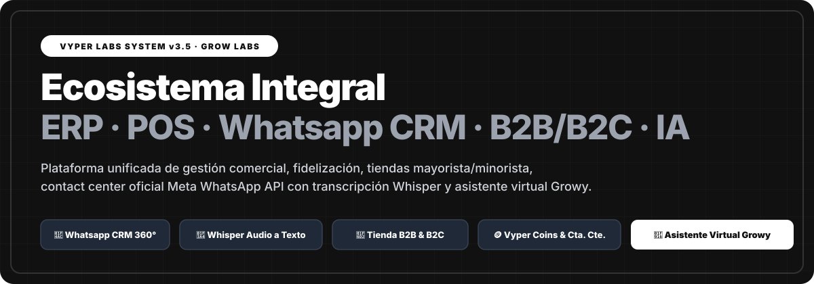

<br />

<p align="center">
  
  
</p>

# VYPER LABS SYSTEM v3.5

### **ERP · POS · Whatsapp CRM · Ecommerce Mayorista B2B & Minorista B2C · Fidelización · Inteligencia Artificial**

[](https://nextjs.org/)
[](https://react.dev/)
[](https://supabase.com/)
[](https://app.builderbot.cloud/)
[](https://openai.com/)

**Ecosistema empresarial todo-en-uno diseñado bajo una estética clínica monocromática (`#111111` / `#FFFFFF`) para centralizar la operación comercial, financiera, logística y de atención al cliente en tiempo real.**

[Explorar Módulos](#-qué-hace-el-sistema-y-galería-visual) · [Cómo Funciona (Arquitectura)](#-cómo-lo-hace-arquitectura-e-ingeniería) · [Ventajas Competitivas](#-ventajas-estratégicas-de-tener-este-sistema) · [Manuales Oficiales](#-manuales-y-centro-de-entrenamiento)

</div>

---

## 📌 Resumen Ejecutivo

**Vyper Labs System v3.5** elimina la fragmentación entre sistemas de facturación de mostrador, tiendas online, planillas de Excel y teléfonos de WhatsApp aislados. En una sola plataforma web de alta velocidad unifica:

1. **Whatsapp CRM 360° en Pantalla Completa (`/admin/crm`)**: Conectado por Webhook Serverless a la API Oficial de WhatsApp Business (Meta), con grabación de notas de voz, **transcripción instantánea de audios con IA (OpenAI Whisper)**, envío y **previsualización universal de archivos (PDF, Excel, Word, Imágenes, Videos)**, cotizador de catálogo dentro del chat y acciones directas sobre la cuenta corriente y puntos del cliente.
2. **Asistente Virtual "Growy IA" & Paleta de Comandos (`Ctrl + K`)**: Copiloto entrenado con toda la documentación del software y conectado en vivo a las métricas de la base de datos (con soporte de dictado por voz).
3. **ERP & Punto de Venta (POS) Multi-Sucursal (`/admin`)**: Ventas rápidas con escáner de SKU, control de egresos, **Cuenta Corriente con recordatorios masivos automáticos** y programa de fidelización **Vyper Coins** (Bronce, Plata, Oro y Platino).
4. **Doble Motor Ecommerce B2B (`/tienda`) y B2C (`/minorista`) + Portal Cliente (`/client`)**: Modo Planilla Rápida para pedidos mayoristas de gimnasios y distribuidores, generador de **Lista de Precios en PDF dinámico**, Personal Shopper IA, seguimiento en vivo (`/pedido/[id]`) y **Política de Stock Flexible** (0 bloqueos de venta).
5. **CMS con Vista Previa en Vivo & Copilotos Administrativos IA**: Editor visual de 12 secciones con *Split-Screen* Desktop/Móvil y *Rollback* de 10 versiones, actualizador masivo de precios por marca/rubro, Copiloto Financiero BI y Motor de Retención Inteligente.

---

## 🖥️ ¿Qué Hace el Sistema? (Galería Visual y Módulos)

### 1. Whatsapp CRM 360° en Pantalla Completa (`/admin/crm`)

Consola de contacto de **3 columnas a pantalla completa (`100vh × 100%`)** integrada directamente en el panel operativo junto a un menú lateral colapsable, diseñada para vender, cobrar y asistir sin cambiar de pestaña.

<p align="center">
  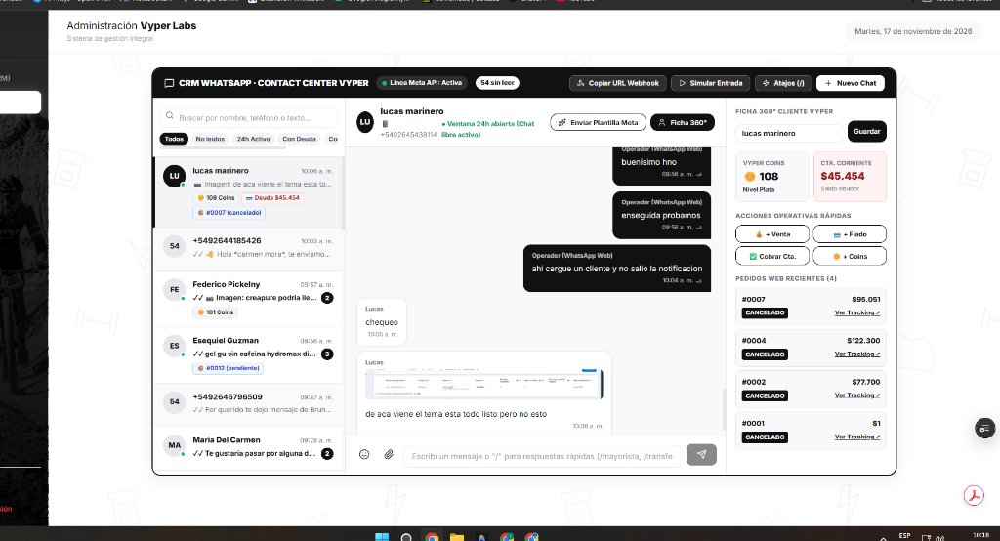
</p>

<p align="center">
  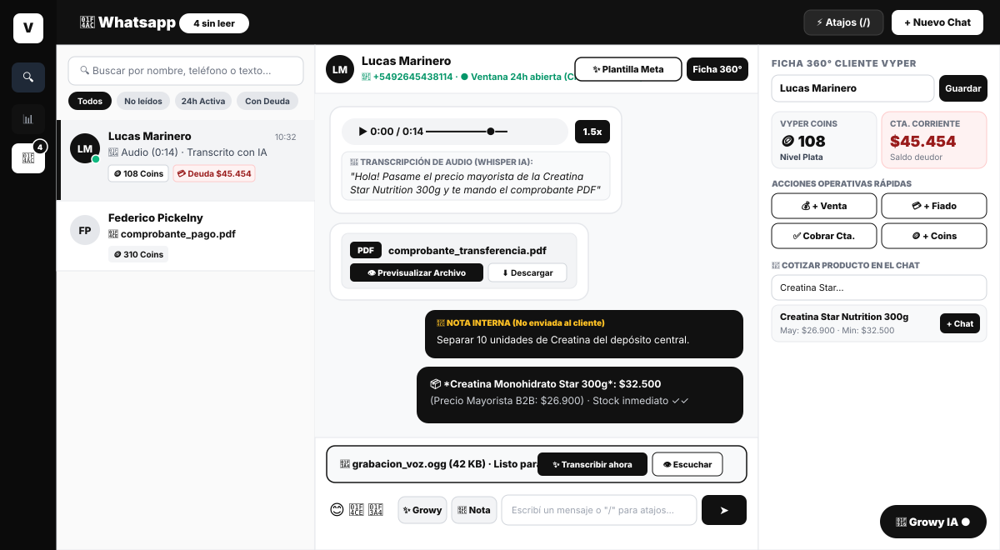
</p>

#### Capacidades Clave del Whatsapp CRM:
- **🎤 Grabación y Envío de Notas de Voz en Vivo**:
  - Grabador integrado en la barra inferior con cronómetro en tiempo real y vista previa de voz a texto mientras hablás.
  - Permite **detener para escuchar y transcribir antes de enviar** o enviar el audio directamente en formato compatible con WhatsApp Cloud API (`.ogg` / `.m4a`).
- **✨ Transcripción de Audios en el Momento (OpenAI Whisper-1)**:
  - **Automática al recibir**: Cuando un cliente envía un audio por WhatsApp, la Edge Function de Supabase lo descarga, lo almacena en el bucket `whatsapp-media` y lo transcribe automáticamente con **Whisper IA**.
  - **Bajo demanda en cualquier burbuja**: Botón **`✨ Transcribir en el momento`** en todos los audios (entrantes, salientes o en previsualización) + control de velocidad de reproducción **`1x / 1.5x / 2x`**.
- **📎 Envío, Recepción y Previsualización Universal de Archivos (`👁️ Previsualizar`)**:
  - Soporte para todo tipo de archivos (`accept="*/*"`, *Drag & Drop* sobre el chat o pegado rápido con `Ctrl + V`): **Imágenes, Audios, Videos, PDFs, Planillas Excel (`.xlsx`, `.xls`, `.csv`), Documentos Word (`.docx`, `.doc`) y Texto**.
  - **Barra de Vista Previa Antes de Enviar**: Permite inspeccionar miniaturas, reproducir audios/videos o abrir el documento antes de confirmar el envío.
  - **Visor Modal Universal en el Chat**: Botón **`👁️ Previsualizar`** en cada archivo recibido o enviado que renderiza PDFs embebidos, visor Microsoft Office Web para Excel/Word, reproductor de video/audio y galería de imágenes sin salir del chat.
- **🛒 Cotizador de Productos en Vivo y Ficha 360° del Cliente**:
  - La columna derecha cruza automáticamente el teléfono del chat con la base de datos para mostrar su saldo de **Vyper Coins**, su **Cuenta Corriente** y sus **Pedidos Web Recientes**.
  - Incluye el buscador **`🛒 Cotizar Producto en el Chat`** para buscar suplementos por nombre o SKU e insertar el precio minorista y mayorista formateado en el mensaje con 1 clic (`+ Chat`).
  - **Acciones Operativas Instantáneas**: Botones **`💰 + Venta`**, **`💳 + Fiado`**, **`✅ Cobrar Cta.`** y **`🪙 + Coins`** que impactan directamente en el ERP desde la conversación.
- **🤖 Respuestas Sugeridas con Growy IA, Notas Internas y Plantillas Meta**:
  - Botón **`✨ Growy`** en la barra de escritura que lee los últimos mensajes (y las transcripciones de los audios) para redactar la respuesta comercial ideal.
  - Botón **`📌 Nota`** para dejar anotaciones internas privadas en el historial del chat (visibles solo para el equipo, nunca enviadas al cliente) y selector de **Etiquetas de Conversación** (`Pendiente Pago`, `Para Despachar`, `Mayorista`, `Resuelto`).
  - Selector de **Plantillas Oficiales Meta (`vyper_notificacion_general`)** con autocompletado de las 4 variables del cliente para contactar fuera de la ventana de 24 horas, más atajos rápidos escribiendo **`/`** (`/mayorista`, `/transferencia`, `/listo`, `/ubicacion`).

---

### 2. ERP, POS con Escáner SKU, Buscador Global (`Ctrl + K`) y Asistente Virtual "Growy"

<p align="center">
  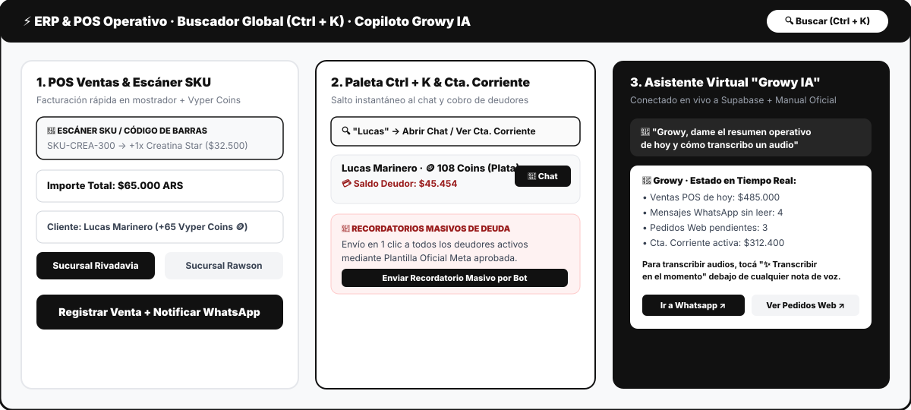
</p>

- **🤖 Asistente Virtual "Growy IA" (`/api/ai/growy`)**:
  - Botón flotante disponible en todas las pantallas administrativas y en el centro de tutoriales.
  - **Conocimiento Total + Datos en Vivo**: Conoce cada regla, botón y flujo del software, y consulta en tiempo real la base de datos de Supabase para responder sobre ventas del día, mensajes sin leer, pedidos pendientes, deuda total en la calle y principales deudores.
  - Incluye **dictado por voz (`🎤`)**, *chips* de consulta rápida y botones de navegación directa en cada respuesta.
- **⌨️ Paleta de Comandos Global (`Ctrl + K`)**:
  - Presionando `Ctrl + K` desde cualquier pantalla se abre el buscador instantáneo para localizar un cliente por nombre o teléfono, saltar directamente a su chat en `/admin/crm?phone=...`, consultar stock/precio de un producto por SKU o hacerle una pregunta a Growy sin tocar el mouse.
- **💰 Punto de Venta (POS) y Control de Egresos (`/admin`)**:
  - Carga de ventas por sucursal (*Rivadavia*, *Rawson*, *Online*) con **Escáner Rápido de SKU / Código de Barras**, cálculo automático de **Vyper Coins** (1 Coin cada $1.000 ARS), envío automático de comprobante por WhatsApp, importador masivo desde Excel y modal de **Resumen Diario de Caja**.
- **💳 Cuenta Corriente y Recordatorios Masivos (`/admin/debt`)**:
  - Panel de deudores activos con KPI de deuda total en la calle, registro de cargos (*fiado*) y pagos parciales/totales.
  - **Envío de Recordatorios Individuales y Masivos por Bot**: Notifica saldos pendientes en 1 clic a todos los deudores seleccionados vía Plantilla Oficial Meta y permite abrir su chat interno con el botón **`💬 Chat`**.

---

### 3. Doble Motor Ecommerce: Mayorista B2B (`/tienda`), Minorista B2C (`/minorista`) y Portal (`/client`)

<p align="center">
  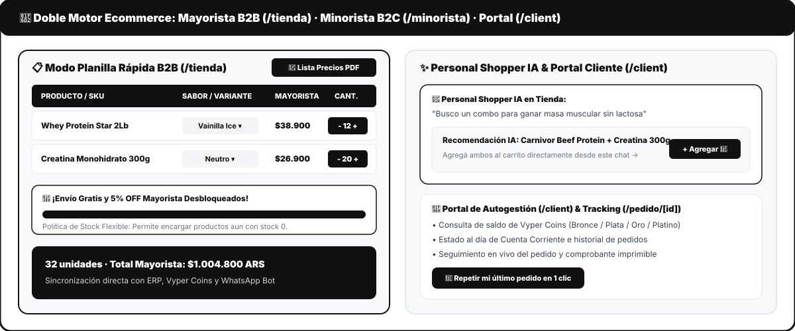
</p>

<p align="center">
  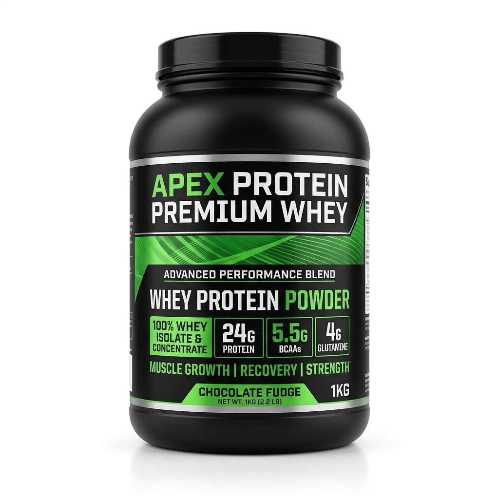
  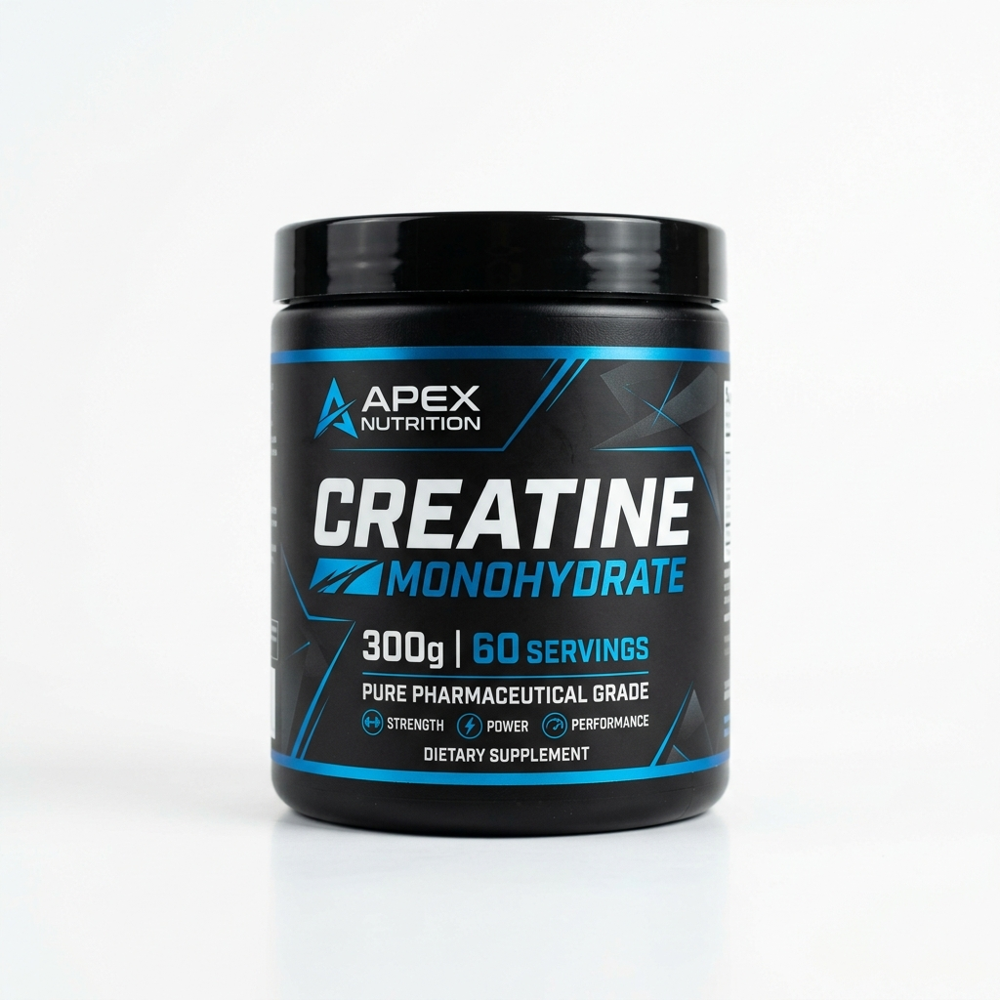
  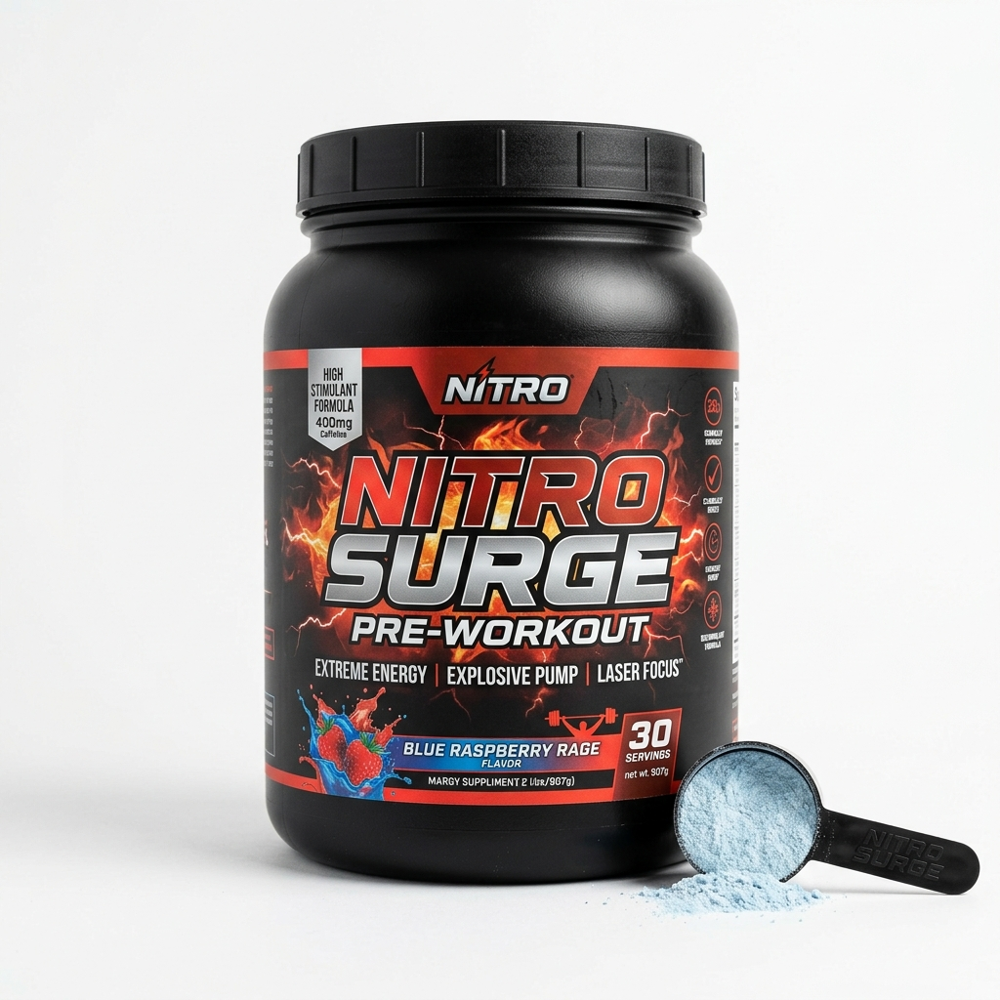
  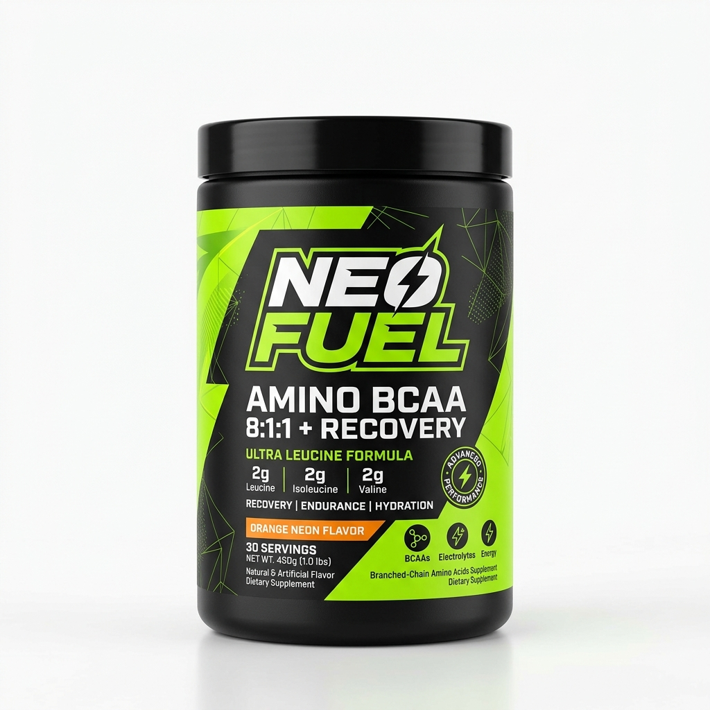
  
  
  
</p>

- **📋 Modo Planilla Rápida B2B (`/tienda`)**:
  - Diseñado para dueños de gimnasios, dietéticas y distribuidores: permite alternar entre la vista de tarjetas y una tabla de alta densidad para filtrar, elegir sabor/variante y cargar pedidos de 50+ unidades en segundos.
- **📄 Lista de Precios en PDF Dinámico**:
  - Generación instantánea en el navegador de un catálogo PDF imprimible en Blanco y Negro con los precios vigentes al minuto, agrupado por rubro y con código SKU.
- **🎯 Barra de Incentivos en Carrito y Checkout de Alta Conversión**:
  - Barra de progreso en vivo que motiva al comprador mostrando cuánto le falta para desbloquear **Envío Gratis** y **Descuento Extra por Volumen**.
  - **Autocompletado por Teléfono, Cupones y Canje de Vyper Coins**: Reconoce al cliente recurrente, muestra sus monedas disponibles y permite **🔁 Repetir su último pedido en 1 clic**.
- **🤖 Personal Shopper IA Flotante en Tienda**:
  - Asesor nutricional y comercial conectado al catálogo real que recomienda suplementos según el objetivo del cliente y permite sumarlos al carrito directamente desde la burbuja de chat.
- **👤 Portal de Autogestión (`/client`) y Tracking en Vivo (`/pedido/[id]`)**:
  - Los clientes consultan 24/7 su nivel VIP de Vyper Coins, sus movimientos de Cuenta Corriente y el estado en vivo de sus pedidos web con comprobante descargable.
- **🔓 Política de Stock Flexible (Cero Ventas Perdidas)**:
  - Por regla de negocio, el sistema **nunca oculta ni bloquea la compra de un producto activo si su stock figura en `0`**, garantizando que los clientes mayoristas y minoristas siempre puedan completar su pedido.

---

### 4. Administración Ecommerce, CMS en Vivo y Copilotos de Gestión IA

| Módulo Administrativo | Ruta | Qué hace y cómo potencia la operación |
| :--- | :--- | :--- |
| **🎨 Editor CMS con Vista Previa e Historial** | `/admin/ecommerce/personalizacion` | 12 secciones editables sin código (Identidad, Hero, Banners, Marquesinas, Incentivos, FAQs), subida *Drag & Drop*, **Vista Previa Split-Screen (Desktop/Móvil)**, **Rollback de las últimas 10 versiones** y **Asesor IA** con aplicación de cambios en 1 clic. |
| **📈 Productos, Precios Masivos y Combos** | `/admin/ecommerce/productos` | ABM completo de productos con variantes, **Actualizador Masivo de Precios** por Marca/Categoría con redondeo automático (`$100`, `$50`, `$10`), **Generador de Descripciones con IA en lote** y creador de **Combos / Packs**. |
| **📦 Pedidos Web Unificados con ERP** | `/admin/ecommerce/pedidos` | Al pasar un pedido a *Procesando* o *Completado*, envía el aviso automático por WhatsApp con el link `/pedido/[id]`, registra la venta en el ERP, acredita **Vyper Coins** o pasa el pedido a **Cuenta Corriente en 1 clic**. |
| **🔫 Compras e Ingreso por SKU** | `/admin/ecommerce/compras` | Registro de facturas de proveedores con lector rápido de SKU para actualizar stock y costos de reposición al instante. |
| **🧠 Analytics BI & Copiloto Financiero** | `/admin/bi` | Dashboard gerencial de ingresos, egresos, margen neto y evolución por sucursal + **Copiloto Financiero IA** que entrega diagnóstico ejecutivo, alertas y 4 acciones semanales + exportación PDF/Excel. |
| **🔄 Motor de Retención con IA** | `/admin/retention` | Detecta clientes en ventana de recompra de suplementos (`15-25 días`, `25-35 días ideal`, `+35 días`) y redacta mensajes personalizados con IA listos para enviar por Bot. |
| **⚔️ Inteligencia Competitiva** | `/admin/competitors` | Mapa interactivo con geolocalización (Leaflet) y matriz comparativa de precios frente a competidores locales. |

---

## ⚙️ ¿Cómo lo Hace? (Arquitectura e Ingeniería)

<p align="center">
  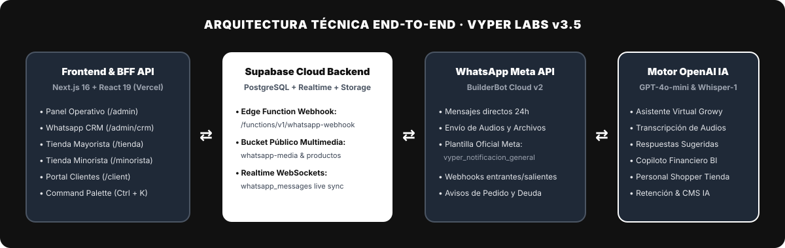
</p>

### Flujo Técnico de Tiempo Real (Webhook + IA + ERP)

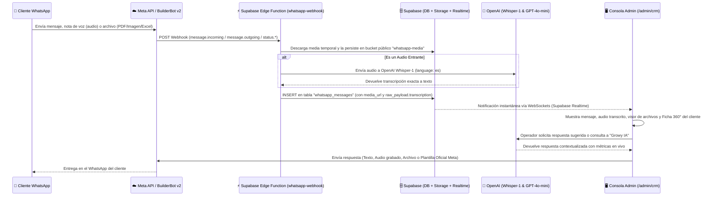

### Pilares de Ingeniería del Sistema:
1. **Frontend & API Layer (`Next.js 16` + `React 19` + `TypeScript`)**:
   - Renderizado híbrido de alto rendimiento desplegado en **Vercel**, con rutas API protegidas mediante autenticación JWT (`jose` + cookies `HttpOnly` con control de roles `superadmin`, `administrador`, `vendedor`).
   - Caché inteligente en cliente con deduplicación de peticiones en lote (`useStoreConfig.ts`) para carga instantánea de las tiendas públicas.
2. **Persistencia, Realtime y Serverless (`Supabase`)**:
   - **Base de Datos PostgreSQL**: Tablas relacionales sincronizadas (`users`, `sales`, `expenses`, `coin_transactions`, `debt_transactions`, `productos`, `categorias`, `rubros`, `marcas`, `listas_precios`, `promociones`, `pedidos`, `pedido_items`, `compras`, `compra_items`, `configuraciones`, `whatsapp_messages`, `whatsapp_shortcuts`).
   - **Edge Function Deno (`supabase/functions/whatsapp-webhook/index.ts`)**: Recibe el 100% de los eventos del bot las 24 horas sin depender del servidor frontend, normaliza teléfonos argentinos al estándar `549...`, descarga archivos multimedia efímeros para guardarlos permanentemente en **Supabase Storage (`whatsapp-media`)** y ejecuta la transcripción automática de notas de voz.
   - **Supabase Realtime**: Suscripción por WebSockets a `postgres_changes` en la tabla `whatsapp_messages` para que cada mensaje o archivo entrante aparezca en pantalla en milisegundos sin recargar la página.
3. **Motor de Mensajería Oficial Meta (`src/lib/builderbot.ts`)**:
   - Integración dual con **BuilderBot Cloud API v2**:
     - Dentro de la ventana de 24 horas: utiliza `POST /api/v2/{id}/messages` para chat libre, envío de notas de voz grabadas en el navegador y todo tipo de documentos adjuntos.
     - Fuera de la ventana de 24 horas y notificaciones transaccionales del sistema: utiliza `POST /api/v2/{id}/whatsapp-template` mapeando automáticamente todos los eventos del sistema a la plantilla universal **`vyper_notificacion_general` (`es_AR`)** con sanitización automática de parámetros Meta.
4. **Doble Motor de Inteligencia Artificial (`OpenAI GPT-4o-mini` + `Whisper-1`)**:
   - **`Whisper-1`**: Transcripción de alta precisión en español rioplatense para audios de WhatsApp (tanto entrantes en el webhook como grabados o bajo demanda en `/api/crm/media`).
   - **`GPT-4o-mini`**: Impulsa los 6 asistentes especializados del ecosistema (**Asistente Virtual Growy**, **Sugeridor de Respuestas CRM**, **Personal Shopper de Tienda**, **Copiloto Financiero BI**, **Redactor de Retención** y **Asesor de Personalización CMS**).

---

## 🏆 Ventajas Estratégicas de Tener Este Sistema

| Antes (Operación Fragmentada) | Con **Vyper Labs System v3.5** (Ecosistema Unificado) | Impacto Directo en el Negocio |
| :--- | :--- | :--- |
| 📱 WhatsApp Web aislado sin contexto de quién escribe, cuánto debe ni qué pidió. | 💬 **Whatsapp CRM 360°**: Ves puntos, deuda y pedidos al lado del chat y operás el ERP sin salir de la conversación. | **-70% en tiempos de respuesta** y atención comercial profesional sin pérdida de chats. |
| 🎧 Escuchar audios largos de clientes cuando estás atendiendo en mostrador. | 🎤 **Transcripción Instantánea Whisper + Velocidad 1.5x/2x**: Leés el contenido del audio en 2 segundos sin necesidad de reproducirlo. | **Atención inmediata en horarios pico** incluso en entornos ruidosos. |
| 📄 Descargar archivos a la PC para poder abrir un comprobante PDF o una lista en Excel. | 👁️ **Previsualizador Universal Integrado**: Abrís PDFs, planillas Office, imágenes y videos directo en un modal dentro del chat. | **Seguridad, orden y validación de comprobantes** en un solo clic. |
| 📉 Ventas perdidas en la tienda online cuando el stock del sistema quedó desactualizado en `0`. | 🔓 **Política de Stock Flexible + Modo Planilla B2B**: Nunca bloquea una compra; los gimnasios y clientes piden en segundos. | **+100% de captura de demanda mayorista y minorista** las 24 horas. |
| 📓 Anotar fiados en cuadernos o planillas y olvidarse de reclamar saldos pendientes. | 💳 **Cuenta Corriente Digital + Recordatorios Masivos por Bot**: Cobros parciales trazables y avisos cordiales en 1 clic por plantilla Meta. | **Recupero acelerado de liquidez** y reducción de morosidad. |
| 🧩 Pagar 5 o 6 suscripciones mensuales distintas (POS, Ecommerce, CRM, Fidelización, BI, Bot). | 🏛️ **Una Sola Plataforma Propia**: Todo integrado sobre la misma base de datos y bajo tu control total. | **Ahorro de costos fijos SaaS** y **datos 100% unificados**. |

---

## 🚀 Instalación y Puesta en Marcha Local

### 1. Clonar el repositorio e instalar dependencias
```bash
git clone https://github.com/lucasmmg12/vyper.git
cd vyper
npm install
```

### 2. Configurar Variables de Entorno (`.env`)
Crear un archivo `.env` en la raíz del proyecto con las siguientes claves:

```env
# Supabase (Base de Datos, Realtime y Storage)
NEXT_PUBLIC_SUPABASE_URL=https://tu-proyecto.supabase.co
NEXT_PUBLIC_SUPABASE_ANON_KEY=tu_supabase_anon_key
SUPABASE_SERVICE_ROLE_KEY=tu_supabase_service_role_key

# Seguridad de Sesión Admin
JWT_SECRET=tu_clave_secreta_jwt

# BuilderBot Cloud v2 / Meta WhatsApp Business API
BUILDERBOT_WEBHOOK_URL=https://app.builderbot.cloud/api/v2/TU_BOT_ID/messages
BUILDERBOT_API_KEY=bb-tu-api-key
OWNER_PHONE=5492646796509

# Inteligencia Artificial (OpenAI GPT-4o-mini & Whisper-1)
OPENAI_API_KEY=sk-proj-tu-api-key
```

### 3. Iniciar servidor de desarrollo o compilar para producción
```bash
# Modo desarrollo
npm run dev

# Compilación optimizada de producción
npm run build
npm start
```

### 4. Desplegar Webhook Serverless en Supabase (Opcional al actualizar la Edge Function)
```bash
npx supabase functions deploy whatsapp-webhook --project-ref ophbmcprxcnpkpndusbe --no-verify-jwt --use-api --yes
```

---

## 📚 Manuales y Centro de Entrenamiento

El repositorio incluye un sistema documental completo en estética **Monocromática Blanco & Negro**:

1. **Centro de Ayuda Interactivo dentro de la App (`/tutorial`)**: [`src/app/tutorial/page.tsx`](./src/app/tutorial/page.tsx) (incluye al asistente virtual **Growy** en vivo).
2. **Manual de Usuario Oficial Imprimible**: [`MANUAL_DE_USUARIO.html`](./MANUAL_DE_USUARIO.html).
3. **Simulador de Entrenamiento Paso a Paso**: [`TUTORIAL_INTERACTIVO.html`](./TUTORIAL_INTERACTIVO.html).
4. **Índice General de Documentación**: [`README_DOCUMENTACION.md`](./README_DOCUMENTACION.md).

---

<div align="center">

**VYPER LABS SYSTEM v3.5** · Diseñado y Desarrollado por **Grow Labs** para **Vyper Suplementos**

</div>
